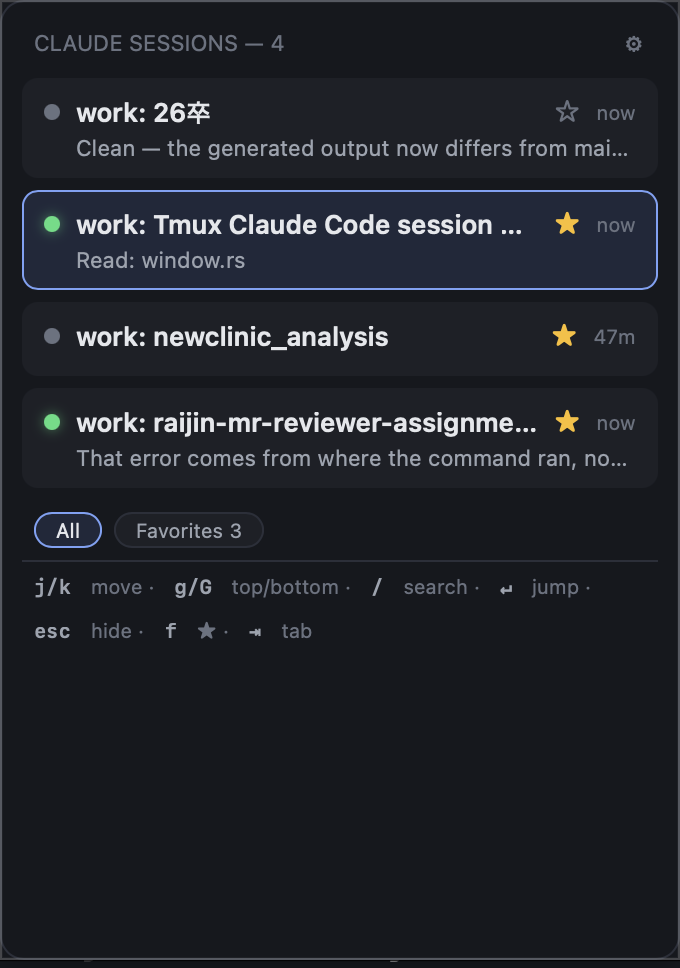

# tmux Claude Monitor

[日本語版 README はこちら](README.ja.md)

A macOS menu-bar app (Tauri v2) that monitors every Claude Code session running inside tmux, in one summonable panel.

If you keep several persistent tmux sessions, each with a Claude Code pane working on something different, you know the problem: which session is still working, which one is waiting for your input, and which one went stale an hour ago? Instead of cycling through sessions with `ctrl+b n`/`p`, press a shortcut and see them all.

<p align="center"></p>

- **Summon / hide with ⌘⇧K** (global shortcut, configurable in `settings.json`; takes effect after restart)
- One card per Claude session: status dot (🟢 working / 🟡 needs input / ⚪ idle or stale), a derived title, a one-line summary of recent activity, and idle time
- **macOS notification the moment a session needs input** (permission dialogs and other structured prompts). A turn that merely ends with a prose question ("Want me to run the tests?") shows amber but never notifies
- **Jump (Enter or click) brings iTerm2 to the front, switches to the exact tmux pane, and hides the panel**
- Floats above every Space and over fullscreen apps (NSWindow collectionBehavior shim)
- **Runs in the background**: launches hidden (the menu-bar icon confirms it's alive), closing the window never quits — quit from the tray menu. The tray shows `● N` while N sessions are waiting for input
- To start at login: System Settings → General → Login Items → add the app

## Keys (vim-style modal)

| Key | Mode | Action |
|---|---|---|
| `⌘⇧K` | anywhere | Toggle the panel |
| `j` / `k` (`↓`/`↑`) | normal | Move selection down / up |
| `g` / `G` | normal | First / last card |
| `/` | normal | Enter search mode (fuzzy matching, matched characters highlighted) |
| `f` | normal | Toggle favorite on the selected session (or click the ☆ on a card) |
| `Tab` | both | Switch between the **All** and **Favorites** tabs (or click the chips at the bottom) |
| `Enter` | both | Jump to the selected session and hide the panel (on a dead favorite: resume it) |
| `Esc` | normal | Hide the panel |
| `Esc` | search | Clear the query and return to normal |
| `Backspace` (empty query) | search | Return to normal |
| `^j` / `^k` (`↓`/`↑`) | search | Move selection while typing |

## Favorites

Press `f` (or click the ☆ on a card) to star a session. `Tab` (or the chips at the bottom) switches between the **All** and **Favorites** tabs.

- The Favorites tab shows live starred sessions as usual. A starred session whose pane or process is gone appears as a dimmed "dead" card with its folder and last-activity age (derived live from the transcript jsonl).
- **Enter (or click) on a dead card resumes it**: a new tmux window is created at the saved working directory running `claude --resume <session-id>`, and the app switches you to it. If the transcript jsonl has been deleted, the card says "transcript missing" and cannot be resumed.
- Favorites are stored in `favorites.json` next to `settings.json` (`~/Library/Application Support/jp.isa.tmux-claude-monitor/`). The file is managed by the app; manual edits apply after an app restart.
- The `claude` binary used for resume is looked up in the tmux server's environment by default. Override it with the `TCM_CLAUDE_BIN` env var or the `claude_bin` setting.

## Build & Install

```bash
pnpm install
pnpm tauri build          # → src-tauri/target/release/bundle/macos/tmux-claude-monitor.app
cp -R src-tauri/target/release/bundle/macos/tmux-claude-monitor.app /Applications/
```

Notifications only work when launched as the bundled .app (not under `tauri dev`). Ad-hoc code signing is fine for personal use.

## First-launch permissions

1. **Notifications** — macOS asks on the first notification → allow
2. **Automation (iTerm2)** — on your first jump, macOS asks
   “"tmux-claude-monitor" wants access to control "iTerm2"” → allow
   (changeable later under System Settings → Privacy & Security → Automation)

## Settings

Click the ⚙ in the header to open `settings.json` in your editor. Edits apply from the next poll, no restart needed (except the shortcut).

| key | default | meaning |
|---|---|---|
| `poll_interval_ms` | 2000 | Poll interval (clamped to ≥ 250 ms) |
| `stale_after_min` | 30 | Minutes of idle before a session counts as stale (gray) |
| `notifications` | true | Enable/disable macOS notifications |
| `window_pos` | null | Panel position (saved automatically when you drag it) |
| `global_shortcut` | "cmd+shift+k" | Summon shortcut (**applies after restart**; if registration fails due to a conflict, the tray menu shows ⚠) |
| `claude_bin` | null | Path to the `claude` binary used when resuming a favorite. `null` = look it up on the tmux server's PATH (the `TCM_CLAUDE_BIN` env var also overrides). Paths containing spaces are not supported |

Location: `~/Library/Application Support/jp.isa.tmux-claude-monitor/settings.json`

## How it works

- Every 2 s: `tmux list-panes -a`, then one `ps` snapshot to find the claude process in each pane's process tree
- Titles and summaries are derived from the tail (256 KB) of `~/.claude/projects/<escaped-cwd>/<session>.jsonl` plus the ruler title Claude Code renders above its input box
- State comes from `tmux capture-pane` heuristics: `esc to interrupt` = working; `❯ 1.` / `Enter to confirm` = waiting for structured input (deliberately **not** `Do you want` — prose turns routinely end with it). All patterns live in `src-tauri/src/state_detect.rs`, tested against real-screen fixtures in `src-tauri/tests/fixtures/`
- Observation is read-only; the only writes to tmux are `switch-client` when you jump and the new window created when you resume a favorite

### Known limitations

- When multiple claude processes share one repo, each pane is matched to a transcript created after its process started (and transcripts claimed by a `--resume` pane are never borrowed). A session resumed from the in-TUI `/resume` picker can still be matched to a busier sibling's transcript until its own file is written
- Jumping targets iTerm2 only. If no tmux client is attached you just get an error toast
- A question buried mid-sentence (not ending with `?`) is not detected as needing input
- The heuristics encode Claude Code's current TUI strings; a Claude Code update that changes them means re-capturing fixtures and adjusting `state_detect.rs`

## Development

```bash
pnpm tauri dev                  # dev app
pnpm test                       # frontend unit tests (vitest)
cd src-tauri && cargo test      # Rust unit tests (fixtures included)
cd src-tauri && cargo run --example scan   # run one poll tick in the CLI and print what it detects
```

Design docs: `docs/superpowers/specs/` · Implementation plans: `docs/superpowers/plans/`

## License

[MIT](LICENSE)
